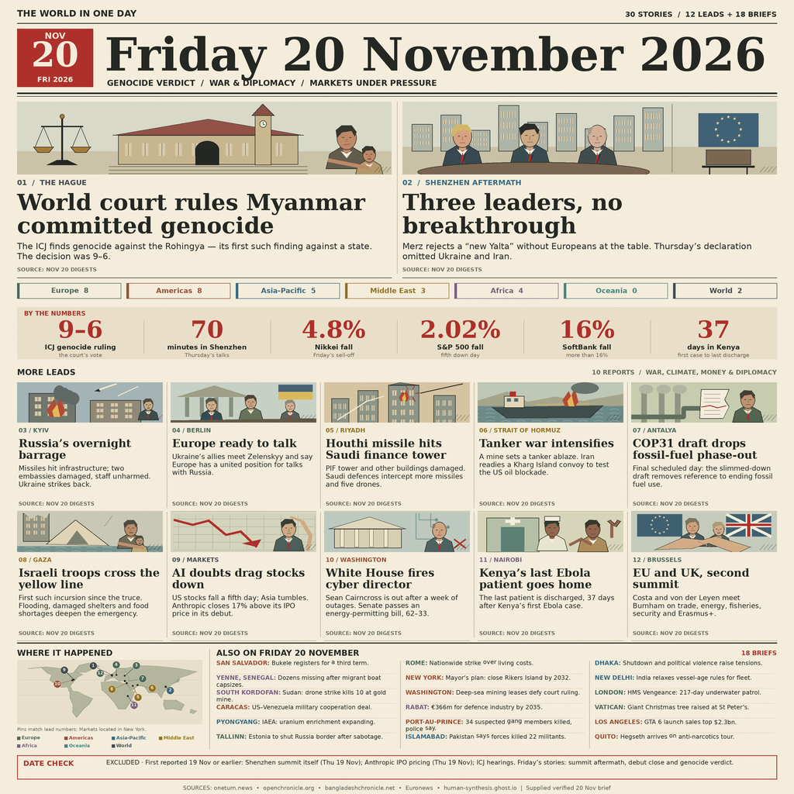

# The World in One Day

[](https://make.fun/bounty/news-image-20261120?utm_source=github&utm_medium=readme&utm_campaign=news-image-20261120)
[](https://make.fun/bounty/news-image-20261120/leaderboard?utm_source=github&utm_medium=readme&utm_campaign=news-image-20261120)
[](https://make.fun/bounty/news-image-20261120?utm_source=github&utm_medium=readme&utm_campaign=news-image-20261120)

An original illustrated newspaper front page for **Friday 20 November 2026**, entered in [make.fun’s news-image-20261120 bounty](https://make.fun/bounty/news-image-20261120?utm_source=github&utm_medium=readme&utm_campaign=news-image-20261120). [View the leaderboard](https://make.fun/bounty/news-image-20261120/leaderboard?utm_source=github&utm_medium=readme&utm_campaign=news-image-20261120).



## The entry

The ICJ genocide verdict on Myanmar leads beside the Shenzhen aftermath and Europe’s response. Ten further illustrated leads cover war, diplomacy, climate, markets, Washington and Kenya. Eighteen briefs fill three compact columns. A six-figure numbers band, seven region chips, numbered world locator and date-check box complete the page.

The content comes only from the supplied `../news-brief.md`. It contains **12 leads + 18 briefs = 30 stories**. Both the page totals and regional totals are calculated from the actual Python story lists. The ICJ and cross-market stories are grouped under World; Shenzhen’s aftermath is Asia-Pacific; Antalya is grouped with Europe. Oceania correctly shows zero. The map uses numbered leaders to separate nearby European locations; the global Markets lead uses New York as a locator, explicitly noted below the map.

The date-check panel excludes the Shenzhen summit itself, Anthropic’s IPO pricing and the ICJ hearings as earlier reporting. Friday’s aftermath, debut close and verdict are included. The 70-minute figure is explicitly marked as Thursday’s talks, and the SoftBank figure’s caption preserves “more than 16%.”

## Run

Python 3 is sufficient for the submission entrypoint. The finished PNG is bundled; no network, renderer, font loading or image library is needed at runtime.

```bash
python3 main.py
```

This writes `/output/entry.png`. For a local output directory:

```bash
MAKEFUN_OUTPUT_DIR=/tmp/news-image-output python3 main.py
```

`main.py` validates the bundled PNG’s signature, dimensions, size and pinned SHA-256, copies it through a temporary file, and verifies the destination bytes. It never downloads anything or reads the clock.

## Build the artwork

The composer needs only Python’s standard library, Pillow 10.2.0 and the installed DejaVu Serif / Sans fonts in `/usr/share/fonts/truetype/dejavu`.

```bash
python3 compose.py
```

The composer draws a 3072 × 3072 canvas and downsamples it to **1024 × 1024**. It builds everything from scratch: the masthead, cream paper fibers, restrained red ink, typography, continent outlines, map pins and twelve distinct editorial illustration banners. Buildings, faces, clothing, flags, fire, ships, waves and chart lines are original Pillow primitives; there are no external images or image-generation assets. Classical newspaper hierarchy, column rules and flat editorial print illustration inform the design.

Every printed line is measured with `draw.textlength`; wrapping and card layout checks reserve space for source tags. The composer checks image size and pixel variance. Paper texture uses a fixed seed, and PNG export uses fixed parameters. Rebuilding in the specified environment reproduces the bundled image. An intentional artwork change requires updating `EXPECTED_SHA256` in `main.py` to the new composer-reported digest.

## Verification

Two separate runs of `main.py` into separate output directories must produce bytes identical to each other and to `entry.png`. The image must decode completely, remain exactly 1024 × 1024, and stay at or below 1,048,576 bytes. `compose.py` prints the actual counts, byte size, SHA-256, variance and regional totals after rendering.

Sources credited in the supplied brief and on the image: oneturn.news, openchronicle.org, bangladeshchronicle.net, Euronews and human-synthesis.ghost.io. Source tags refer to those supplied November 20 digests collectively; no unsupported per-story source attribution is added.

## License

MIT. See [LICENSE](LICENSE).
